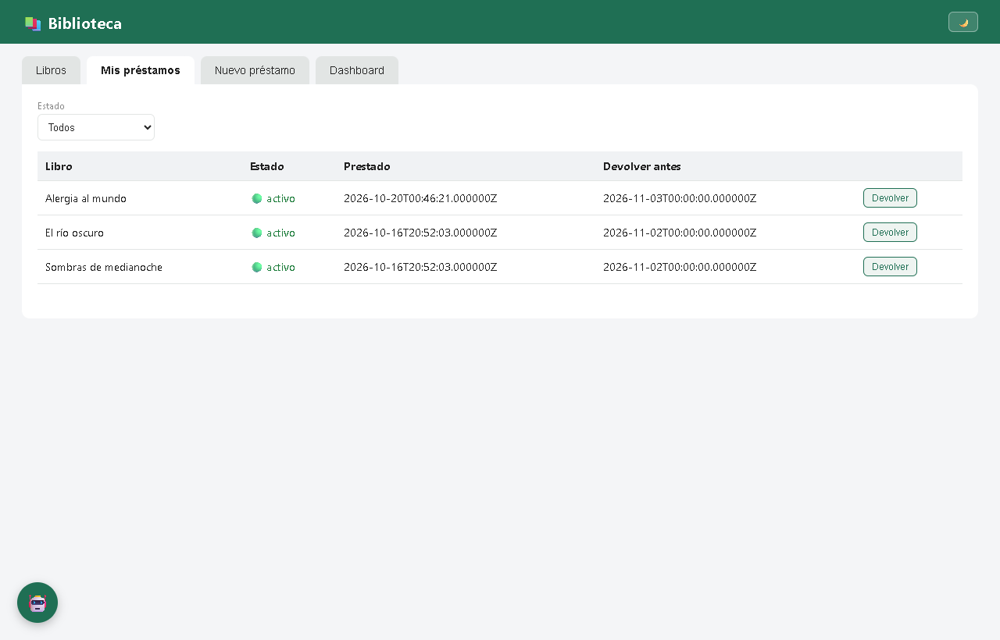
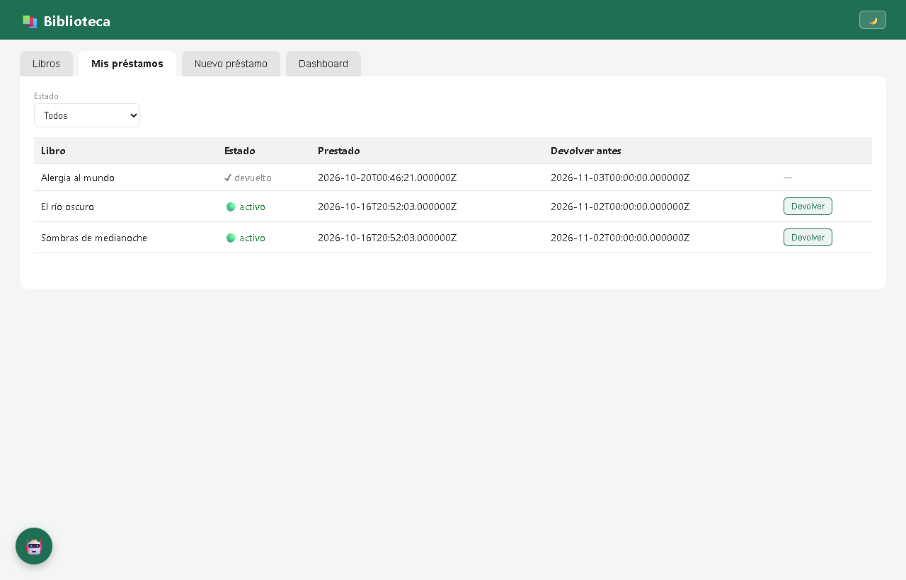
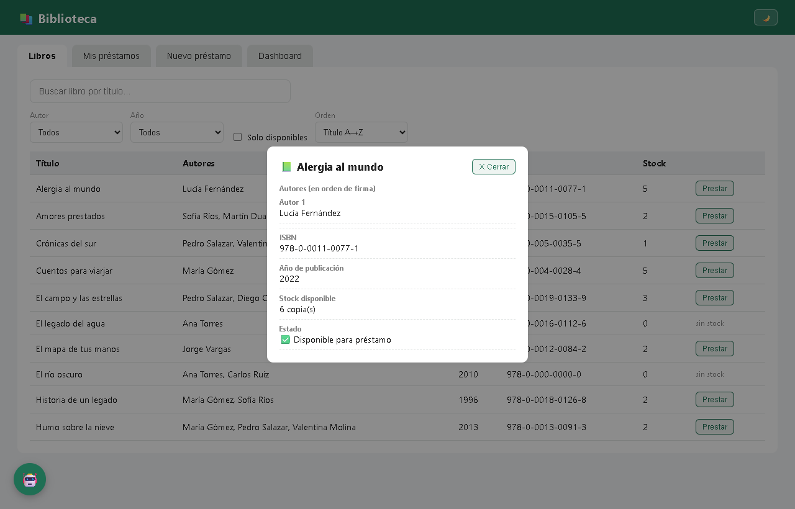
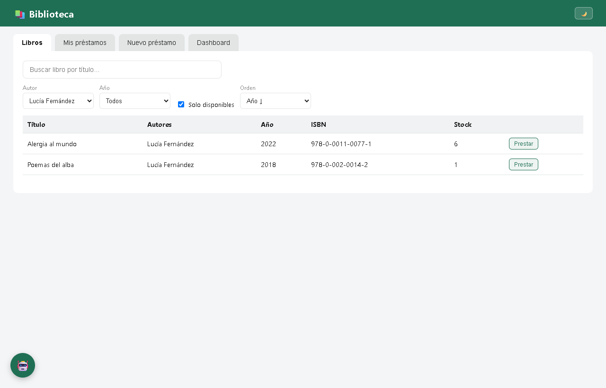
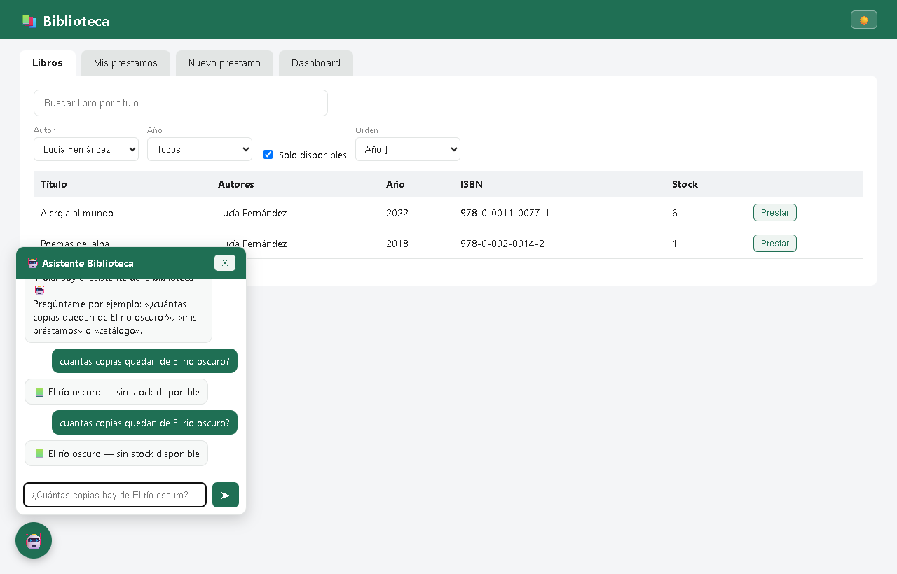
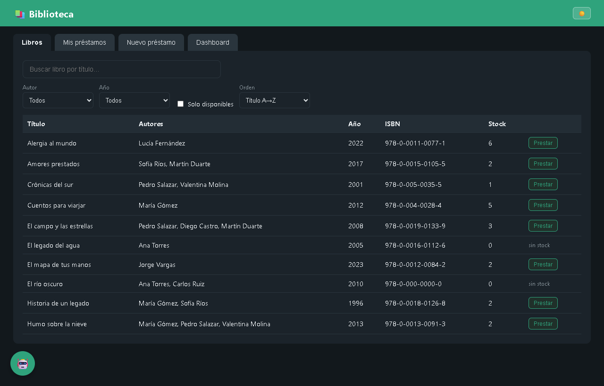
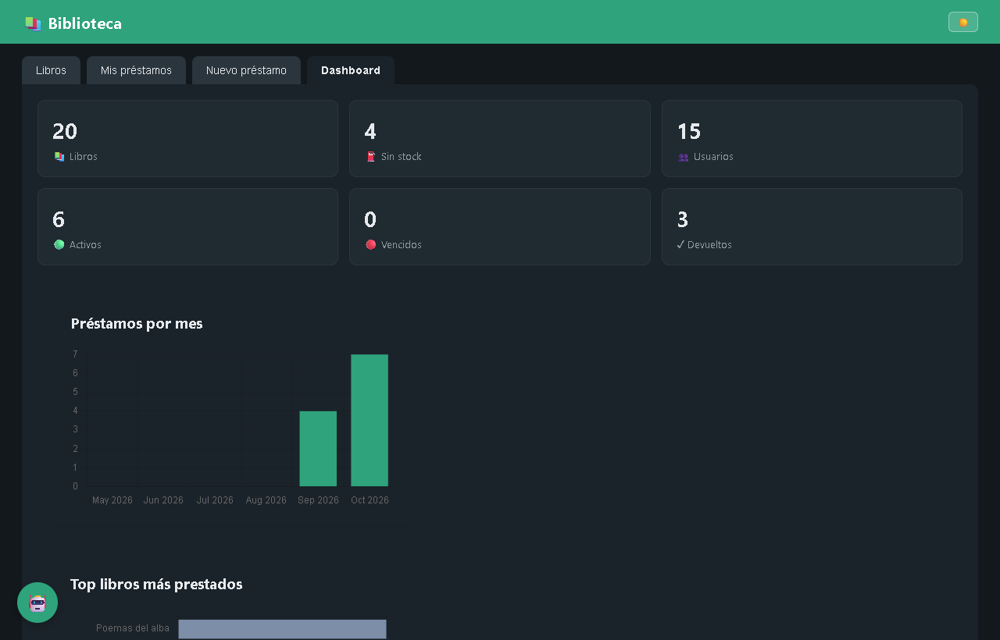

# Biblioteca API Laravel + PostgreSQL (+ frontend Blade/JS)

Sistema de gestión de biblioteca API REST autenticada con Sanctum,
reglas de negocio de préstamos y una interfaz web básica en Blade + JS vanilla.

## Instalación

```bash
composer install
cp .env.example .env
php artisan key:generate

# editar .env con tus credenciales de PostgreSQL (DB_CONNECTION=pgsql)
php artisan migrate --seed
php artisan serve    # http://localhost:8000
```

- Login demo (web y API): `usuario1@example.com` / `password` (los 15 usuarios comparten contraseña de demo; el usuario 15 está inactivo).
- Si tu PostgreSQL está en otro puerto, ajusta `DB_PORT`.

## Comandos útiles

```bash
php artisan prestamos:marcar-vencidos   # marca vencidos (más de 15 días de retraso)
php artisan reporte:biblioteca          # reporte: top prestados, vencidos, sin stock
```

## API (resumen)

Todos los endpoints requieren `Authorization: Bearer <token>` salvo `POST /api/login`.

| Método | Ruta | Descripción |
|---|---|---|
| POST | /api/login | Token Sanctum |
| GET | /api/libros | paginación + filtros (titulo, autor, anio, disponibles) |
| GET | /api/libros/{id} | libro con autores (orden pivote) |
| POST/PUT | /api/libros[/{id}] | crear/actualizar (+autores con orden_autor) |
| DELETE | /api/libros/{id} | soft delete |
| GET/POST | /api/prestamos | listar (eager loading) / crear con reglas de negocio |
| PUT | /api/prestamos/{id}/devolver | marcar devuelto + reponer stock |
| GET | /api/estadisticas | métricas del dashboard |

Reglas de negocio: sin stock no se presta; máximo 3 préstamos activos por usuario;
solo usuarios activos prestan; vencidos (+15 días) se marcan automáticamente.

Front: `http://localhost:8000` (búsqueda en tiempo real, préstamos y dashboard).

Postman: colección `Parte 7 — Postman` en la carpeta superior.

### Endpoints añadidos (mejoras)

| Método | Ruta | Descripción |
|---|---|---|
| GET | /api/prestamos/mios | préstamos del usuario autenticado, filtro opcional `estado` |
| GET | /api/autores | catálogo de autores (filtro de libros y formulario) |
| POST | /api/asistente | asistente local: consultas del catálogo, disponibilidad y préstamos del usuario |

`GET /api/libros` acepta combinado `autor_id`, `anio`, `disponibles` y `orden`, y devuelve los `anios` disponibles en `meta`.

## Entregables (docs/)

Todos los entregables que no son codigo del proyecto estan en la carpeta [docs/](docs/):

- docs/01_sql_y_diagramas/   -> Parte 1: SQL + diagrama ER (draw.io, mermaid, HTML, PNG)
- docs/02..06_*/             -> Partes 2-6: README por parte con las rutas exactas del codigo en el proyecto
- docs/07_postman/           -> Parte 7: coleccion Postman + environment (importar en la app)
- docs/08_teoria/            -> Respuestas teoricas en Word (.docx) y Markdown (.md)
- docs/Informe_Biblioteca.pdf -> Documento global con la explicacion de cada punto


## Interfaz (mejoras)

- Pestaña «Mis préstamos» con badges de estado y botón «Devolver» (confirmación + toast).
- Modal de detalle del libro: autores en orden de pivote, ISBN, año, stock y estado.
- Filtros combinables de libros (autor + año + disponibilidad + ordenación).
- Asistente integrado (chatbot local que consulta la BD real, sin servicios externos).
- Modo oscuro con persistencia en `localStorage` y spinners de carga.
- Dashboard con gráficos: préstamos por mes y top libros más prestados (Chart.js).
- Descarga en `CSV` del historial en la pestaña «Mis préstamos».

## Capturas (validación visual)

La carpeta [docs/capturas/](docs/capturas/) contiene las pantallas de la app para validar cada funcionalidad:

| Archivo | Qué valida |
|---|---|
|  `01_login.png` | Login con credenciales demo (Sanctum) |
|  `02_libros.png` | Listado de libros: autores en orden de pivote, stock, avisos "sin stock" |
|  `03_busqueda.png` | Búsqueda por título (filtro del API) |
|  `04_nuevo_prestamo.png` | Formulario de préstamo: solo libros con stock, fecha estimada hoy +15 días |
|  `05_error_regla_negocio.png` | Regla de negocio desde el backend: toast HTTP 409 "el usuario ya tiene 3 activos" |
|  `06_dashboard.png` | Dashboard con estadísticas de `/api/estadisticas` |
|  `07_mis_prestamos.png` | Pestaña «Mis préstamos»: préstamos del usuario autenticado (`GET /prestamos/mios`) con badges de estado |
|  `08_devolucion.png` | Botón «Devolver» con confirmación: toast de éxito y stock repuesto |
|  `09_detalle_libro.png` | Modal de detalle del libro: autores, ISBN, año, stock y estado |
|  `10_filtros.png` | Filtros combinables de libros: autor + año + disponibilidad + ordenación |
|  `11_chatbot.png` | Asistente integrado (chatbot local sobre la BD): disponibilidad, «mis préstamos», «catálogo» |
|  `12_modo_oscuro.png` | Tema oscuro con persistencia en `localStorage` |
|  `13_dashboard_graficos.png` | Dashboard con gráficos: préstamos por mes y top libros más prestados (Chart.js) |
_dashboard_graficos.png\ | Dashboard con gráficos: préstamos por mes y top libros más prestados, gracias a Chart.js |

El diagrama entidad-relación está en [docs/01_sql_y_diagramas/diagrama_er.png](docs/01_sql_y_diagramas/diagrama_er.png).

## Autor

Santiago Marulanda Leguizamo
Desarrollador de Software | Datos e IA aplicada

- GitHub: https://github.com/Marusan94
- Email: santiago.marulandal@udea.edu.co
- Portfolio: https://capidevo.vercel.app/