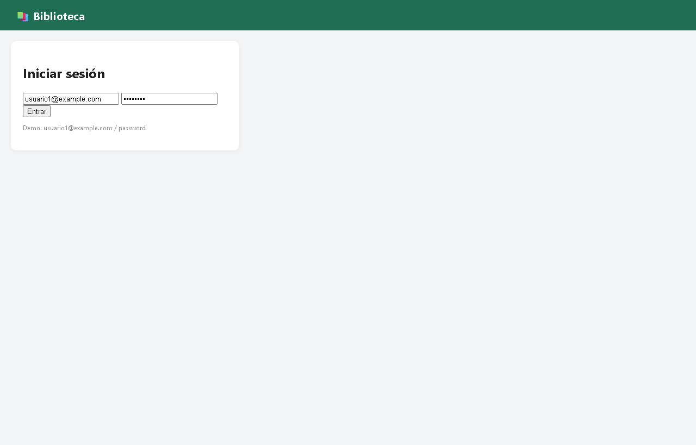
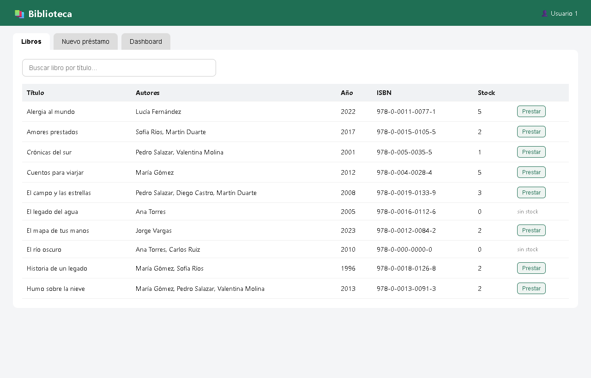
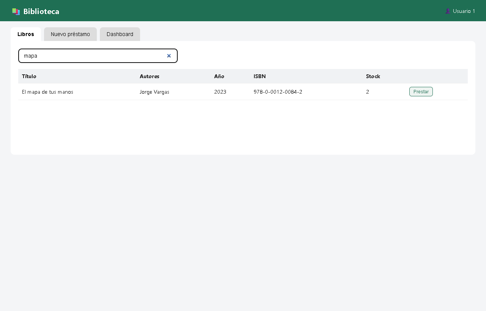
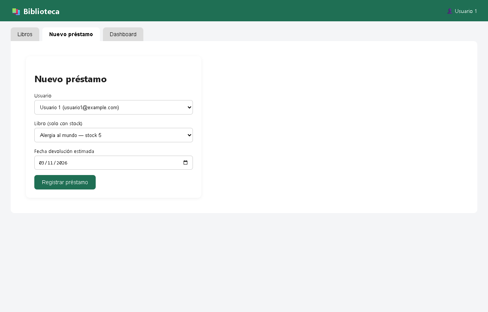
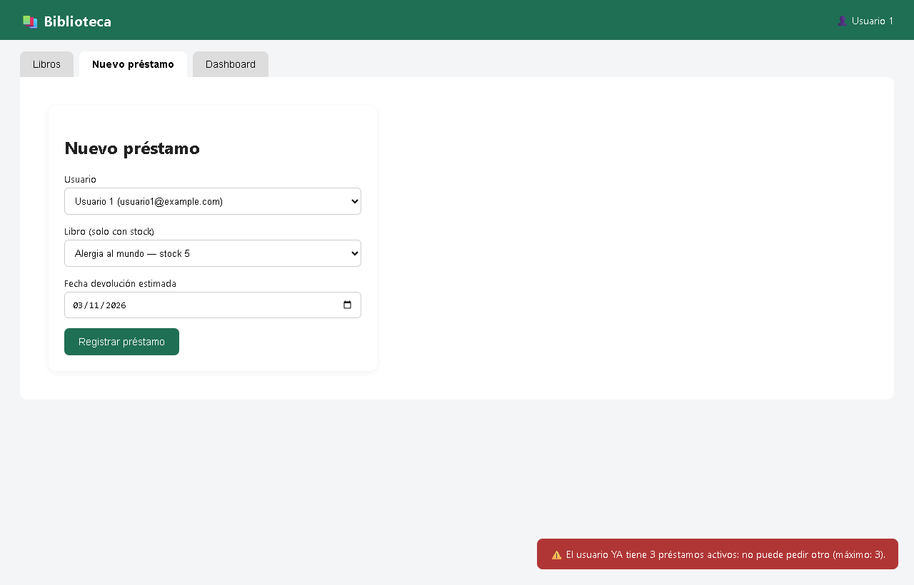
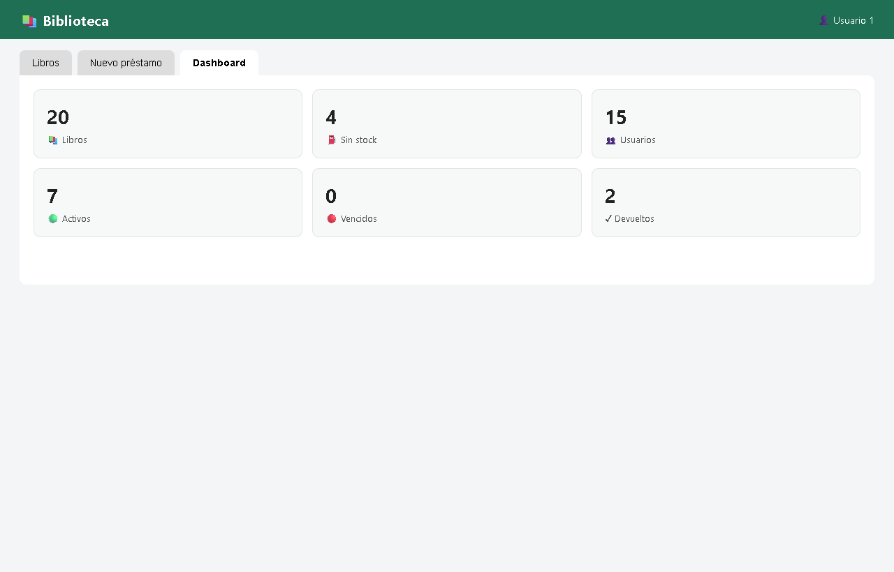

# Biblioteca API Laravel + PostgreSQL (+ frontend Blade/JS)

Sistema de gestión de biblioteca: API REST autenticada con Sanctum,
reglas de negocio de préstamos y una interfaz web básica en Blade + JS vanilla.

## Instalación

```bash
composer install
cp .env.example .env
php artisan key:generate

# editar .env con tus credenciales de PostgreSQL (DB_CONNECTION=pgsql)
php artisan migrate --seed
php artisan serve    # http://localhost:8000
```

- Login demo (web y API): `usuario1@example.com` / `password` (los 15 usuarios comparten contraseña de demo; el usuario 15 esta¡ inactivo).
- Si tu PostgreSQL esta¡ en otro puerto, ajusta `DB_PORT`.

## Comandos útiles

```bash
php artisan prestamos:marcar-vencidos   # marca vencidos (más de 15 días de retraso)
php artisan reporte:biblioteca          # reporte: top prestados, vencidos, sin stock
```

## API (resumen)

Todos los endpoints requieren `Authorization: Bearer <token>` salvo `POST /api/login`.

| Método | Ruta | Descripción |
|---|---|---|
| POST | /api/login | Token Sanctum |
| GET | /api/libros | paginación + filtros (titulo, autor, anio, disponibles) |
| GET | /api/libros/{id} | libro con autores (orden pivote) |
| POST/PUT | /api/libros[/{id}] | crear/actualizar (+autores con orden_autor) |
| DELETE | /api/libros/{id} | soft delete |
| GET/POST | /api/prestamos | listar (eager loading) / crear con reglas de negocio |
| PUT | /api/prestamos/{id}/devolver | marcar devuelto + reponer stock |
| GET | /api/estadisticas | métricas del dashboard |

Reglas de negocio: sin stock no se presta; máximo 3 préstamos activos por usuario;
solo usuarios activos prestan; vencidos (+15 días) se marcan automáticamente.

Front: `http://localhost:8000` (búsqueda en tiempo real, préstamos y dashboard).

Postman: colección `Parte 7 ” Postman` en la carpeta superior.

## Entregables (docs/)

Todos los entregables que no son codigo del proyecto estan en la carpeta [docs/](docs/):

- docs/01_sql_y_diagramas/   -> Parte 1: SQL + diagrama ER (draw.io, mermaid, HTML, PNG)
- docs/02..06_*/             -> Partes 2-6: README por parte con las rutas exactas del codigo en el proyecto
- docs/07_postman/           -> Parte 7: coleccion Postman + environment (importar en la app)
- docs/08_teoria/            -> Respuestas teoricas en Word (.docx) y Markdown (.md)
- docs/Informe_Biblioteca.pdf -> Documento global con la explicacion de cada punto

## Capturas (validación visual)

La carpeta [docs/capturas/](docs/capturas/) contiene las pantallas de la app para validar cada funcionalidad:

| Archivo | Qué valida |
|---|---|
|  `01_login.png` | Login con credenciales demo (Sanctum) |
|  `02_libros.png` | Listado de libros: autores en orden de pivote, stock, avisos "sin stock" |
|  `03_busqueda.png` | Búsqueda por título (filtro del API) |
|  `04_nuevo_prestamo.png` | Formulario de préstamo: solo libros con stock, fecha estimada hoy +15 días |
|  `05_error_regla_negocio.png` | Regla de negocio desde el backend: toast HTTP 409 "el usuario ya tiene 3 activos" |
|  `06_dashboard.png` | Dashboard con estadísticas de `/api/estadisticas` |

El diagrama entidad-relación está en [docs/01_sql_y_diagramas/diagrama_er.png](docs/01_sql_y_diagramas/diagrama_er.png).

